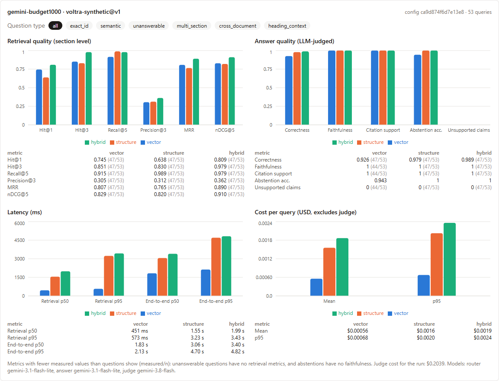
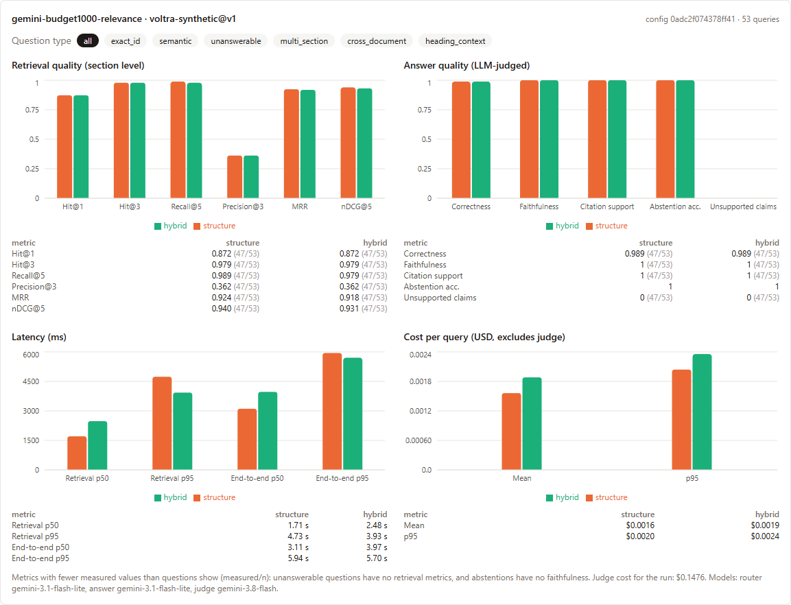
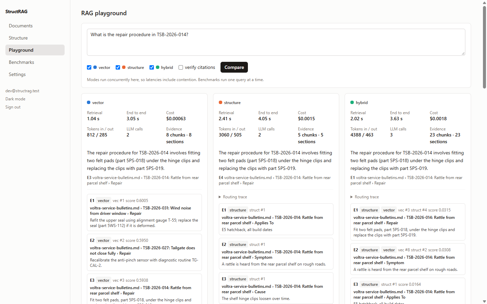
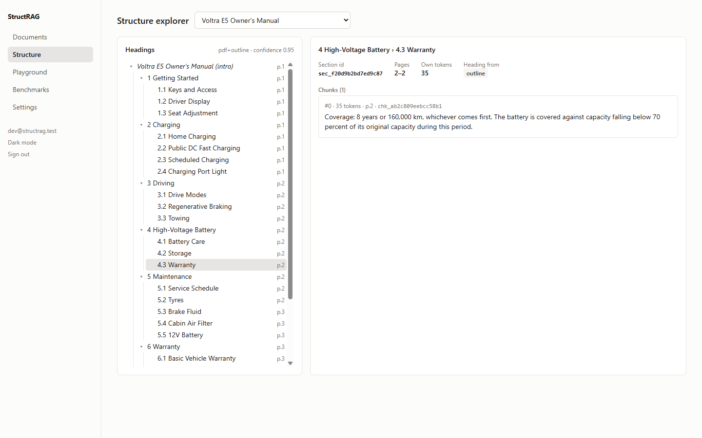

# StructRAG

A structure-aware RAG platform that answers the same question three ways and
measures which way works better:

| Mode | Retrieval |
|---|---|
| **vector** | query embedding → pgvector nearest chunks. Sees no document structure. |
| **structure** | an LLM routes the question through each document's table of contents, coarse to fine, and reads the chosen sections. |
| **hybrid** | both, fused with weighted Reciprocal Rank Fusion, optional cross-encoder rerank, deduplicated, budgeted. |

All three feed one grounded-answer pipeline (same model, prompt, temperature
and context budget), so answer differences come from retrieval. Inspired by
IBM's STAIR work on table-of-contents routing; it does not reproduce STAIR's
fine-tuned router or its published results.

Design and trade-offs: [docs/ARCHITECTURE.md](docs/ARCHITECTURE.md).
Evaluation corpus and how to run a benchmark: [eval/README.md](eval/README.md).

## Results

First benchmark, 2026-10-29: 53 questions over 4 documents. Every mode gets the same 1,000-token
context budget and the same Gemini answer model. Full method, caveats and raw records:
[eval/README.md](eval/README.md).



| | vector | structure | hybrid |
|---|---|---|---|
| Hit@1 (right section ranked first) | 0.74 | 0.64 | **0.81** |
| Hit@3 | 0.85 | 0.83 | **0.98** |
| MRR | 0.81 | 0.76 | **0.89** |
| Answer correctness (LLM-judged) | 0.93 | 0.98 | **0.99** |
| End-to-end latency, p50 | **1.8 s** | 3.1 s | 3.4 s |
| Cost per query | **$0.00056** | $0.00156 | $0.00187 |

- **Vector** is cheapest and fastest. It misses questions whose key identifier appears only in a
  parent heading: three service-bulletin questions, where it returned the wrong bulletin's
  "Repair" section and correctly said it could not answer.
- **Structure** routing found the right sections (Recall@5 0.99) but ranked them in reading order.
- **Hybrid** retrieved best overall, at about 3.4× the cost of vector.
- Every claim every mode made was supported by the evidence it cited.

### Follow-up: relevance order inside routed sections

Setting `structure_order: "relevance"` lets the router choose sections, then sorts each section's
chunks by query similarity. Measured on the *same* routing decisions, structure-mode MRR went from
**0.76 → 0.92** and Hit@1 from **0.64 → 0.87**: 14 questions improved and none got worse. That puts
structure level with hybrid on ranking, at about 83% of its cost. It is opt-in for now.



These results come from one run on a synthetic corpus built to stress repeated headings,
graded by an LLM. Treat them as a working comparison, not a general verdict.

## Screenshots

**Playground**: one question, three modes side by side, with citations, provenance, latency and cost.
Vector ranks two *other* bulletins' Repair sections first; structure goes straight to TSB-2026-014.



**Structure explorer**: the parsed heading tree with pages, heading source and chunks for each section.



## Layout

```
backend/    FastAPI app (app/), CLI, tests
frontend/   React + Tailwind dashboard
supabase/   config + SQL migrations (schema, RLS, storage bucket)
eval/       synthetic corpus generator, gold dataset, benchmark results
```

## Run locally

Needs Docker, Node 20+, Python 3.11+ and an OpenAI-compatible API key
(OpenRouter by default; it serves both chat and embedding models).

```bash
npx supabase start
```

```bash
cd backend && python -m venv .venv && .venv/Scripts/pip install -e ".[dev]"
```

Copy `backend/.env.example` to `backend/.env` and fill it in from
`npx supabase status` (`SECRET_KEY`, `PUBLISHABLE_KEY`) plus `LLM_API_KEY`.
Copy `frontend/.env.example` to `frontend/.env.local` with the publishable key.

```bash
cd backend && .venv/Scripts/python -m app
```

```bash
cd frontend && npm install && npm run dev
```

Open http://localhost:5173, create an account (local auth needs no email
confirmation), upload documents, and open the Structure, Playground and
Benchmarks pages. API docs are at http://localhost:8000/docs.

On Linux/macOS use `.venv/bin/...` instead of `.venv/Scripts/...`.

## Tests

```bash
cd backend && .venv/Scripts/python -m pytest
```

Unit tests need nothing running. Integration tests (`-m integration`) run
against the local Supabase stack with a deterministic fake LLM; they create
throwaway users and are skipped when the stack is down. They cover upload →
index → structure, RLS isolation between users, idempotent re-indexing with
embedding reuse, routing validation and fallback, hybrid provenance,
citations, and that benchmarks refuse a fake LLM and abort on billing/auth
errors.

## API

All routes need `Authorization: Bearer <Supabase access token>`.

| Method | Path | |
|---|---|---|
| POST | `/api/documents` | multipart upload (`file`, optional `title`, `metadata` JSON) |
| GET | `/api/documents`, `/api/documents/{id}` | list / status / parse metadata |
| GET | `/api/documents/{id}/structure` | heading tree |
| GET | `/api/sections/{id}` | section text and chunks |
| POST | `/api/documents/{id}/reindex` | queue a re-index |
| DELETE | `/api/documents/{id}` | delete document, index and stored file |
| POST | `/api/retrieve/{vector\|structure\|hybrid}` | retrieval only |
| POST | `/api/ask` | retrieve + grounded answer for several modes |
| POST/GET | `/api/eval/datasets` | load / list gold datasets |
| POST/GET | `/api/benchmarks`, `/api/benchmarks/{id}` | run / inspect benchmarks |
| GET | `/api/analytics` | latency, tokens, cost, index footprint |
| GET/PUT | `/api/settings` | per-user retrieval config |

```bash
curl -s localhost:8000/api/ask -H "Authorization: Bearer $TOKEN" -H "Content-Type: application/json" \
  -d '{"query": "How long is the battery warranty?", "modes": ["vector", "structure"], "config": {"verify_citations": true}}'
```

Errors share one envelope: `{"error": {"code", "message", "details"}}`.

## Security

- RLS on every table (`owner_id = auth.uid()`). The API itself runs each
  user's queries as a restricted role with that user's JWT claims, so the
  database enforces isolation even for backend code. `anon` and
  `authenticated` have no table grants: the browser only talks to Auth and the API.
- The service/secret key stays on the server (storage access, job queue).
  The frontend only gets the publishable key.
- Uploads: type allow-list, size limit, private bucket, per-owner paths.
- Document text is treated as untrusted: nonce-delimited in prompts, and the
  router's ids are validated against what it was shown.

## Deploy

`docker compose up --build` builds the API and the dashboard (nginx) and
points them at the local Supabase stack. For a hosted Supabase project:

1. `npx supabase link --project-ref <ref>` then `npx supabase db push` to apply migrations.
2. Put the project's `DATABASE_URL`, `SUPABASE_URL`, secret key and LLM key in the API's environment.
3. Build the frontend with the project's URL and publishable key (`VITE_*` build args).
4. Run `python -m app.ingest.worker` as a separate process and set `WORKER_ENABLED=false`
   on the API if you scale API replicas.

Nothing here deploys automatically.
